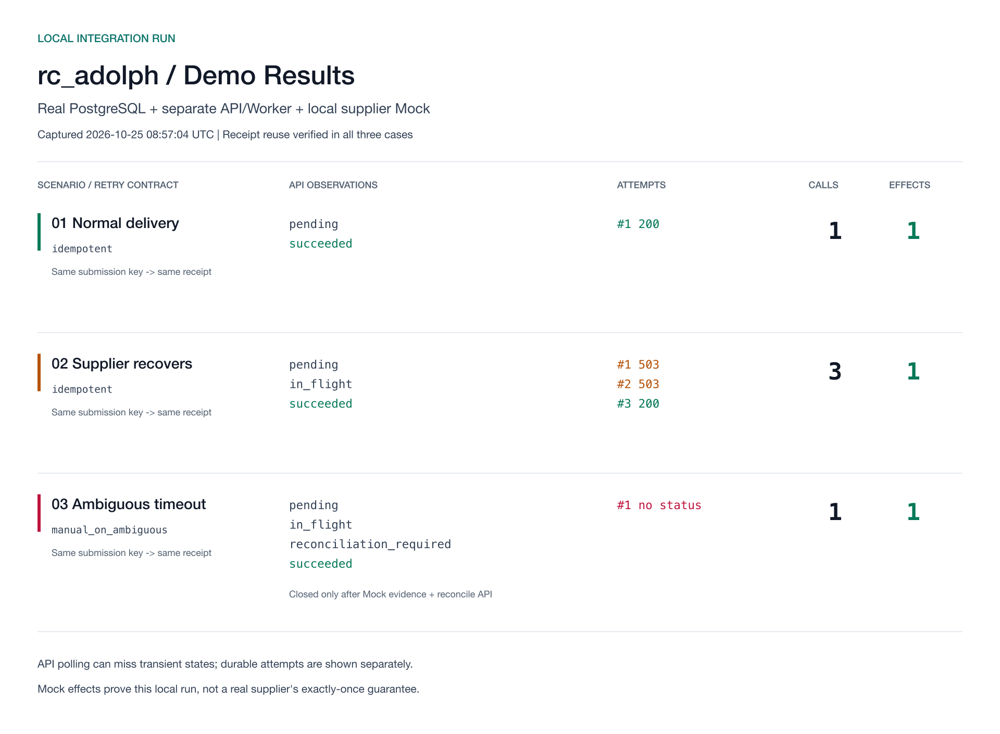
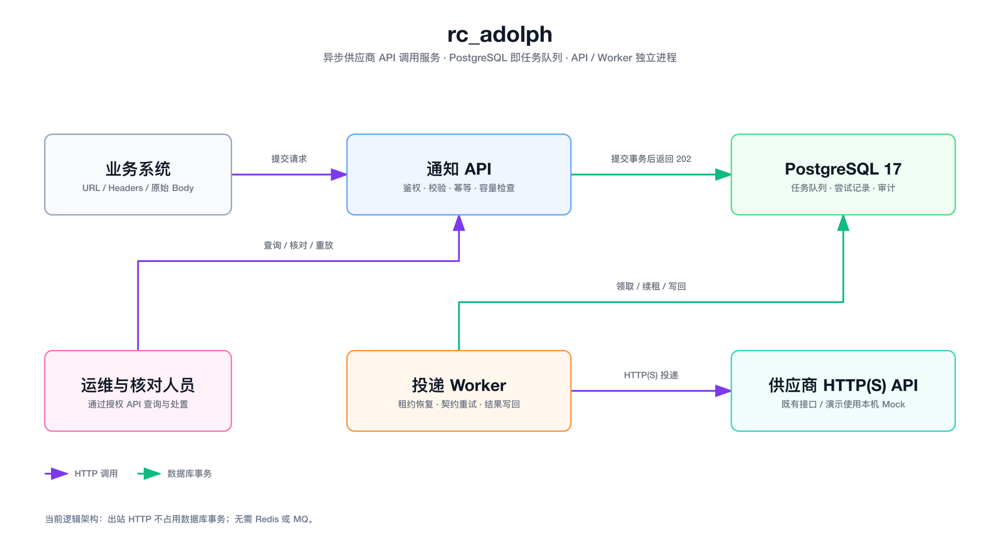

# rc_adolph

面向供应商已有 HTTP(S) API 的可靠异步调用服务。业务系统提交目标 URL、Header 和原始 Body，服务持久化后返回回执，再由独立 Worker 投递；不要求供应商改造接口，也不把请求转换成统一事件信封。

适用场景包括注册后的广告归因、付款后的 CRM 状态更新、购买后的库存通知。本项目是面试作业的可运行实现，包含生产化设计与本地验证，**不宣称已通过生产验收，也不承诺外部副作用 exactly-once**。

## 快速演示

推荐体验 PostgreSQL 主实现。需要 Python 3.12、Docker CLI 和正在运行的 Docker daemon，不需要供应商账号或 Redis/MQ。

```sh
python3.12 -m venv .venv
.venv/bin/python -m pip install --require-hashes -r requirements.lock
make demo-production PYTHON=.venv/bin/python
```

演示自动创建全新的临时 PostgreSQL、临时密钥与配置，启动真实 API、独立 Worker 和本机 Mock，结束后关闭进程并删除自己的测试数据库。它不读取项目已有的 `.secrets`，不接受外部数据库地址，不操作既有容器。首次运行可能需要下载固定版本镜像。

| 场景 | 应观察到的行为 |
| --- | --- |
| 正常投递 | 接收后异步成功；相同入口 key 复用同一回执 |
| 供应商临时故障 | Mock 返回两次 503 后恢复，三次调用产生一次副作用 |
| 发送后响应超时 | 无安全重试契约时进入待核对，不盲目重发；核对 Mock 已送达后关闭 |



上图由本机实际运行的[脱敏报告](docs/assets/demo-report.json)生成，是执行结果可视化，不是另行实现的管理后台。重新生成报告：

```sh
.venv/bin/python -m notifier.production.demo --output /tmp/notifier-demo.json
```

输出文件必须不存在；报告不包含 token、数据库连接串或请求快照。没有 Docker 时，可用标准库运行 `make demo` 体验 [SQLite 原型](docs/sqlite-demo.md)，但它不代表 PostgreSQL 状态机或生产部署。

## 架构与核心流程



这是逻辑架构，不表示已部署多副本或多可用区。[SVG](docs/assets/architecture.svg) 与[图源](docs/assets/architecture.json)一并保留。

1. **接收**：认证与租户授权、校验目标及供应商操作范围、入口幂等与容量准入；同一 PostgreSQL 事务保存任务及加密快照，提交成功才返回 202。
2. **领取**：Worker 使用 `SKIP LOCKED` 领取到期任务，在短事务中创建 attempt、租约与并发占用；供应商 HTTP 在事务外执行。
3. **完成**：按响应、发送阶段、预算和供应商重试契约决定成功、重试、失败或待核对。写回需匹配 token 且租约有效。
4. **处置**：查询保留任务与 attempt；明确失败可审计重放，结果不明必须提交核对结论和证据引用。

PostgreSQL 中的任务记录本身就是队列，不存在再向独立 MQ 写入的第二个提交点。API 和 Worker 是两个进程，不是两个独立业务微服务。

### 请求契约

调用方使用 Bearer token 和入口 `Idempotency-Key` 提交到 `POST /v1/notifications`。请求中的 Body 保持为原始字符串，JSON 和表单均不由服务重新套壳：

```json
{
  "url": "https://orders.vendor.example/v1/orders",
  "method": "POST",
  "headers": {
    "Content-Type": "application/json",
    "Idempotency-Key": "supplier-order-1001"
  },
  "body": "{\"order_id\":\"1001\",\"amount_cents\":100}",
  "credential_ref": "orders-v1"
}
```

这是契约示例，不会发送真实订单；`credential_ref` 由服务端按[运行手册](docs/production-runbook.md)配置，供应商凭据不放进业务请求。首次持久化返回 202，相同入口 key 与相同请求返回原回执及 200，修改请求复用 key 返回 409。任务详情、失败重放与核对分别使用 `GET /v1/notifications/{id}`、`POST /{id}/replay`、`POST /{id}/reconcile`（后两者以 `/v1/notifications` 为前缀并要求对应角色）。

## 系统边界

| 在本系统中解决 | 明确不解决 |
| --- | --- |
| 已接收请求持久化、异步发送、入口去重、有限重试、崩溃恢复、查询与核对 | 业务系统提交之前的事件丢失；关键业务应在自身事务中写 outbox |
| 供应商已有 URL、不同 Header 与原始 UTF-8 Body | 通用事件订阅平台、扇出门户、二进制流、严格任务顺序 |
| 多租户角色、凭据引用、加密快照、出站限制与容量保护 | 供应商内部事实验证；人工证据引用仍需有权限人员核实 |
| 本地 2xx 接收判定和可配置重试安全契约 | 200 内嵌业务失败、异步回执、OAuth 自动刷新与动态签名；接入时需专用 Adapter |

当前支持 POST/PUT/PATCH，Body 上限 128 KiB。生产模式只允许授权 HTTPS 目标；演示模式仅显式放行本机 Mock。没有已验证的吞吐量或可用性 SLO，不用假定 QPS 推导技术选型。

## 可靠性与失败处理

采用**可恢复、允许重复的有界投递**，而非无条件“至少成功一次”。永久错误、长期不可用或预算耗尽后必须保留可处置记录，不能靠无限重试保证业务成功。

| 结果 | 决策 |
| --- | --- |
| 2xx | 按当前通用契约标记成功 |
| 可确认尚未发送的网络故障 | 在租约、截止时间和次数预算内重试 |
| 408/425/429/5xx、部分发送、响应丢失 | 只有供应商幂等窗口覆盖下一次完整发送预算，或业务明确容忍重复时，才允许自动重试；否则待核对 |
| 永久拒绝、安全校验失败、预算耗尽 | 无历史未决结果时失败；不能抹除更早 attempt 的不确定性 |
| 超长 `Retry-After` | 不提前截短等待；任务暂停或待核对，共享 origin 进入运维 hold |
| Worker 崩溃 | 回收过期租约；旧 Worker 无权写回，外部已发生的副作用仍不能撤销 |

生产状态包括 `pending`、`in_flight`、`succeeded`、`failed`、`reconciliation_required`、`paused`。`outcome_uncertain` 独立记录跨尝试未决结果；解除冷却不等于确认未送达。

入口 `Idempotency-Key` 用于本服务回执去重；供应商 key 用于供应商自己的协议，两者不可混淆。供应商重试契约有三种：已验证窗口的 `idempotent`、业务容忍重复的 `duplicate_tolerant`、结果不明转人工的 `manual_on_ambiguous`。

## 工程取舍与 AI 判断

| 选择 | 理由与代价 |
| --- | --- |
| PostgreSQL 任务账本，暂不上 Redis/MQ | 接收、幂等和调度状态可原子提交；代价是自维护租约、轮询、热点锁、索引膨胀与 vacuum，不能推导出无限吞吐 |
| 模块化单体，API/Worker 分进程 | 独立运行与扩容，状态归同一上下文；不先拆调度、重试、审计等大量微服务 |
| 有限重试与显式核对 | 不把永久坏请求变成无限积压；代价是存在人工处置成本 |
| 保留 SQLite 零依赖原型，但不作为主实现 | 方便快速体验；单机故障域及不同状态模型需明确区分，不能与 PostgreSQL 混称生产方案 |

AI 提出或扩展过的平台化方向中，本版不采纳通用订阅门户、topic/fanout、Kafka、多地域活跃投递和 exactly-once 承诺。它们缺少当前题目规模与基础设施依据。后期实现已经比原题要求的 MVP 更重，因此此次交付停止继续堆功能，把重点放在可运行性、正确性边界与可解释的决策上。完整过程见 [AI 协作说明](docs/ai-collaboration.md)，不把 AI 自主选择伪装成人工逐项认可。

演进以实测触发：先测入口延迟、队龄、锁等待、数据库 IO 与保留数据规模；需要时优化索引、清理和分区。若 PostgreSQL 调度竞争仍无法满足已确认的 SLO，或出现独立消费群、扇出需求，再采用 **Job + Outbox 同事务 → relay → MQ → 读取权威账本的 Worker**，逐租户切换单一调度权。更换队列不能消除外部重复副作用。

## 测试与代码导航

```sh
# 增加测试与 lint 依赖
.venv/bin/python -m pip install --require-hashes -r requirements-test.lock
make test PYTHON=.venv/bin/python

# 完整数据库回归：只允许专用隔离测试库，勿使用业务数据库
NOTIFY_TEST_DATABASE_URL='postgresql://<isolated-test-only-dsn>' \
  make test PYTHON=.venv/bin/python
```

未提供测试 DSN 时，PostgreSQL 用例会跳过，不能称作完整通过。已执行结果及环境限制见[验证记录](docs/verification.md)；没有把本机测试当成 HA、压测或真实供应商契约证明。

| 路径 | 责任 |
| --- | --- |
| `notifier/production/api.py`、`config.py` | API、身份、租户与供应商授权 |
| `notifier/production/store.py`、`migrations/` | 任务状态、事务、租约、核对、保留与迁移 |
| `notifier/delivery.py`、`production/runtime.py` | HTTP 阶段与预算、DNS/IP/TLS、结果分类 |
| `notifier/worker.py` | 领取、续租和执行并发 |
| `notifier/mock_supplier.py`、`production/demo.py` | 供应商故障注入、一键端到端演示 |
| `tests/`、`.github/workflows/ci.yml` | 回归、真实 PostgreSQL、进程及告警规则验证 |

## 设计附录与提交状态

- [架构、故障边界与选型](docs/architecture.md)、[领域词汇](GLOSSARY.md)、[ADR](docs/adr/0001-transactional-delivery-ledger.md)。
- [本机容器与生产运行手册](docs/production-runbook.md)：长期保留服务、角色、凭证、监控、迁移和恢复；不需要为了作业启用整套生产部署。
- [行业方案对比](docs/industry-review-2026-10-24.md)：借鉴成熟设计，但不声称性能或可靠性优于成熟产品。
- [提交清单](docs/submission-checklist.md)：Git、可复现演示、敏感文件排除、AI 会话材料。

原题要求 GitHub 仓库名为 `rc_{your_nickname}`，项目与公开仓库名称统一为 `rc_adolph`，已推送至 `ado1ph/rc_adolph` 的 `main` 分支。远端 CI 结果以仓库 Actions 页面为准。`artifacts/ai-session.zip` 当前明确只有协作摘要，不是完整原始对话；正式提交前仍需提供真实对话导出并按清单重新打包，不能用本地代码测试替代。
